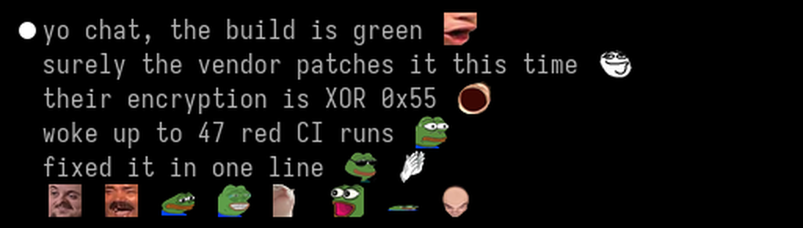

# claude-twitch-emotes

Real Twitch emotes in [Claude Code](https://claude.com/claude-code). When Claude writes `KEKW`, `Pog` or `monkaS`, your terminal draws the actual emote, inline, in the reply.



745 emotes out of the box: the classics, the most used 7TV and FFZ emotes, and the Twitch globals. Add any other one by name in a few seconds.

## Install

In Claude Code, running inside [WezTerm](https://wezterm.org):

```
/plugin install twitch-emotes --marketplace translibrius/claude-twitch-emotes
```

Then, once:

```
/emotes setup
```

That's it. The first session downloads the emote font (5 MB) to `~/.twitch-emotes`. `/emotes setup` adds two lines to your wezterm config so it uses that font as a fallback, and keeps a backup next to it. WezTerm reloads by itself, no restart.

Now tell Claude to talk like Twitch chat, or just ask it to say `Pepega Clap`.

## Commands

| Command | What it does |
|---|---|
| `/emotes setup` | Hook the font into your wezterm config (once) |
| `/emotes` | Toggle rendering on and off |
| `/emotes list` | Every emote name the font has |
| `/emotes add NAME` | Add an emote by its exact 7TV name. Shows up live, no restart |
| `/emotes add NAME URL` | Add any image (png, gif, webp) under a name you pick |
| `/emotes prompt N` | How many emote names Claude is told about (default 150, 0 for none) |
| `/emotes any-terminal on` | Swap emotes outside WezTerm too (see below) |

`/emotes add` builds the font on your machine, so it needs [uv](https://docs.astral.sh/uv) or Python with `pip install fonttools pillow`. Everything else needs nothing.

## How it works

Terminals can't reliably show inline images from inside a TUI (and on Windows, ConPTY eats the escape codes). Every terminal can draw a font, though.

- `tool/emotefont.py` packs emotes into a color bitmap font, `Twitch Emotes`, one glyph per emote in a private-use Unicode range (U+100000 and up).
- The mod swaps emote names for those glyphs when a reply is drawn. Only the drawing changes: the transcript, and what Claude reads back, stay plain text.
- Names are only swapped when they stand alone as a word with exact casing. Code blocks, `inline code`, `Pogchamp` and `D:\paths` are left alone.
- Claude gets a short note listing the most used emote names, so it knows what it can use. It is told to only use them when the conversation already has that tone.

## Limits

- **Static.** Animated emotes show one frame. Fonts don't animate.
- **One text row tall**, three cells wide. Chat-sized, not billboard-sized.
- **WezTerm only, for now.** It is the only terminal this is tested in. Others may work with the font set as a fallback and `/emotes any-terminal on`; reports welcome.
- An emote named like an ordinary word would hijack that word, so the bulk import skips names that are plain English (`Sure`, `WHAT`) and all-lowercase ones. Add one back with `/emotes add`, or block one by putting its name in `~/.twitch-emotes/block.txt`.

## Build your own pack

```
uv run tool/emotefont.py build --top 3000 --ffz 500
```

Curated emotes live in [`tool/core.txt`](tool/core.txt) (`Name URL [@frame]`), and win over the bulk lists. Codepoints are append-only, so rebuilding never reshuffles what an old transcript shows.

## Uninstall

`/plugin uninstall twitch-emotes`, delete the two `twitch-emotes` lines from your wezterm config, delete `~/.twitch-emotes`.

## Credits

Emotes belong to their creators and are served by [7TV](https://7tv.app), [BetterTTV](https://betterttv.com), [FrankerFaceZ](https://www.frankerfacez.com) and Twitch. This project is not affiliated with any of them, or with Anthropic. If one of yours is in the pack and you want it out, open an issue and it is gone.

Code is MIT.
